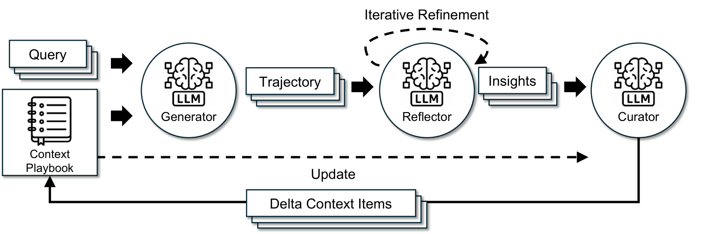

> 图 4：ACE 框架。受 Dynamic Cheatsheet 启发，ACE 采用智能体架构，包含生成器、反思器和整理器三个专门组件。[原图](ace.html#S3.F4)

- 生成器：产生轨迹
- 反思器：提炼 insight
- 整理器：整合上下文的更新

> 三项关键创新
> [原文](ace.html#S3.p2.1)

1. Reflector 专门提取，与整理工作分离
2. 差量更新
3. 增长与精练机制

> “要点”的概念
> [原文](ace.html#S3.SS1.p1.1)

包括结构化条目要点 + 元数据 + 内容（复用策略或失败模式）

---

实验：

AppWorld + 领域专用基准，基于ReAct

DeepSeekV3.1

---

局限：

未必所有应用都需要完整上下文。设计按需调用的逻辑？
