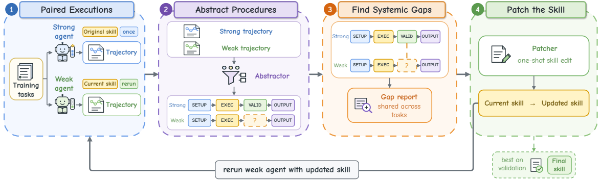

> 给定同一个固定技能，强弱智能体的差别不仅体现在任务成功率，也体现在明显不同的操作过程；我们用执行轨迹的图编辑距离（GED）量化这种差异
> [原文](skill-transfer.html#S1.p2)

> 我们把强弱智能体的轨迹抽象成共享的结构表示，定位操作过程中的差距，并迭代修补技能以弥合这些差距
> [原文](skill-transfer.html#S1.p4)

> 图 2：技能迁移概览。（1）强智能体在原始技能 S0 下运行一次；弱智能体在每轮迭代中，使用当前技能 Sk 在相同训练任务上重新运行。（2）抽象器把两条轨迹转成带类型的节点序列（§3\.2）。（3）对齐成对结构，定位每个任务的差距，并将系统性差距汇总为报告（§3\.3–§3\.4）。（4）补丁器仅编辑技能，且一次完成，得到 Sk\+1，再用于重跑弱智能体。迭代结束后，在验证集 V 上选出 S⋆。[原图](skill-transfer.html#F2)

---

## 方法

分别有强智能体和弱智能体，推理使用同一技能，差别是基座模型

任务：（任务说明，标准答案）

智能体 + 技能 + 任务—产生—轨迹t + 最终输出o

对照标准答案评价最终输出o，抽象建模并比较t

技能迁移目标：适配技能S，最大化弱智能体在领域任务的期望成功率

[原文](skill-transfer.html#S3.1.heading)

**抽象执行结构**：从轨迹输出有序过程节点序列，每个节点是两级标签 + 支持性细节。vi=(c1i, c2i, di)

> c1i 是一级标签，取自六种固定且与领域无关的过程角色：SETUP（准备）、EXECUTE（主要领域操作）、VALIDATE（提交前正确性检查）、RECOVER（应对失败）、OUTPUT（保存结果）和 OTHER（不属于上述类别）。c2i 是二级标签，由抽象器创造的简短自由文本标记，用于命名具体步骤，例如 borderless\_table\_fallback 或 formula\_write\_or\_repair。
> [原文](skill-transfer.html#S3.2.p2b)

同一轮对话抽象两条轨迹，确保等价步骤转换成等价标签

**结构性差距定位**：使用 GED 量化差异，计算成本，一级标签匹配二级标签不同的0.5，一级标签不匹配二级标签匹配的0.75，都不匹配的修改和增删为1。用GED计算两条轨迹之间差异。

**差距类型**：比较匹配/不匹配的节点得到差距（missing_node, weak_node, extra_wrong_node, order_diff, wrong_skill_routing）

**多案例汇总**：

**策略选择与补丁提示**：将修复分为多种策略：MANDATE, GUIDANCE, PROHIBITION, HARD-STOP, REORDER, DESCRIPTION-PATCH。与差距类型分别各自对应

**技能修补**

**迭代循环**

---

## 实验

bench: spreadsheetbench, officeQA, DABench

agent: gpt5.4 as strong, 5.4-mini, 4.1-mini as weak; qwen3.5-122B-A10B as strong, qwen3.5-4B as weak

skill: anthropic 官方 xlsx 技能; finance + ripgrep for officeQA, data-scientist + statistical-analysis for DABench.

> 那这里其实技能的使用不太对，因为都用预制技能的话不符合实际使用的预期，我在想能不能用强模型生成技能交给弱模型用

baseline: no skill, S0, EvoSkill, 本文

metric: Pass%, Cell Match, GED; 相对误差; By Q, Pr Q

---

一句话汇总：本文对轨迹进行建模，再使用 GED 来比较和计算轨迹差异，产生技能的修补。

可能存在的问题和改进：

1. 是否真的一定要逼模型使用相同的轨迹？使用 GED 会不会扼杀模型自由选择路径的潜力
2. 用官方的技能不太符合实际使用的预期，能否使用强模型生成技能交给弱模型使用
3. 跨模型家族的迁移没有覆盖
