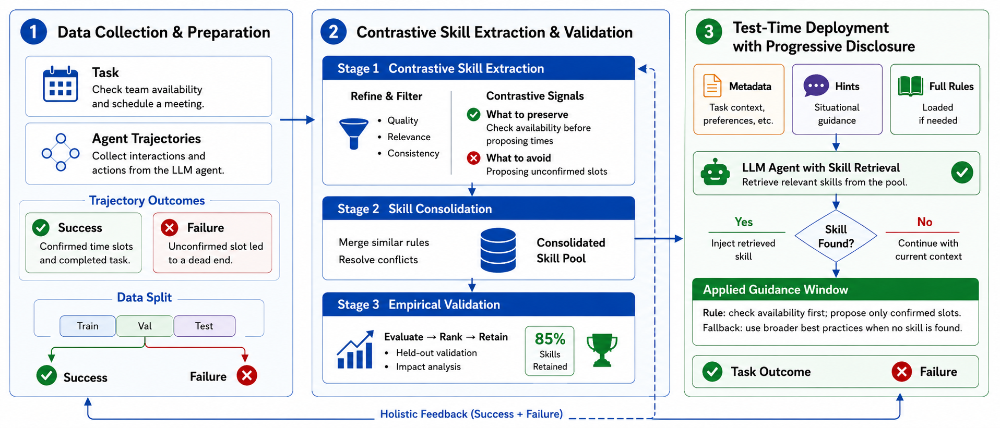

> 图 2：SkillForge 的详细工作流。[原图](skillforge.html#F2)

SkillForge 的动机比较简单，收集一些或成功或失败的对比轨迹，从轨迹的对比中提取候选的指南，验证这些指南然后封装成 Skill 的形式允许 LLM 自由的检索。

---

> 轨迹收集
> [原文](skillforge.html#sf015)

这里使用不同采样方式，收集相同任务不同结果的轨迹，构造成功与失败集

> 对比式技能提取与验证
> [原文](skillforge.html#sf022)

1. 用生成器 G 来识别关键决策点、失败模式，然后评估并修改候选（可操作、范围、通用、简介）
2. 技能整合：规范化为Skill，检索相似，消除冗余
3. 经验验证：保留足够频繁调用、贡献足够的候选

> 分层按需检索
> [原文](skillforge.html#sf034)

这个就有点水，其实就是包装成了skill，然后LLM可以自行决定是否调用、装载对应的技能

---

实验部分

Baseline: No Skill, Self-Gen Skill, SkillForge

Model: Gemeni 2.5 Flash

Benchmark: t2 bench airline, retail (客服领域) + terminal bench

Metric: Pass@1, Passk

---

可能的不足：

评估范围广度不足、失败模式单一、检索能力与模型性能挂钩

> 评估范围。
> [原文](skillforge.html#sf065)
